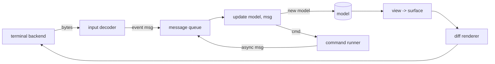

# teacup — C++17 TUI library

A Bubbletea/Elm-inspired terminal UI library: a pure `update` function drives an
immutable model, a pure `view` function paints a surface, and the runtime owns all
side effects (terminal I/O, timers, async work).

## 1. Goals

| Goal | How it is met |
| --- | --- |
| Functional core | `init` / `update` / `view` free functions; model never touched by the runtime |
| Separation of view and model | `view(model, canvas)` gets a const model and a write-only canvas |
| Surfaces and widgets | `surface` (owning cell grid) + `canvas` (clipped view) + composable widgets |
| Input events | Decoded key / mouse / resize / paste / focus events delivered as messages |
| Easy to operate | Header-first API, one call to run: `teacup::run(app)`; single CMake target |
| Modern look | Truecolor, 256-color and ANSI fallback, Unicode borders, gradients, rounded boxes, diff-based flicker-free repaint |

Non-goals (for now): Windows console API backend (POSIX first, backend is
pluggable), full grapheme-cluster segmentation (we ship a compact east-asian
width table), accessibility bridges.

## 2. Architecture



Layers, bottom-up:

1. **Primitives** — `geometry`, `color`, `style`, `cell`.
2. **Raster** — `surface` (owning grid), `canvas` (clipped, offset view of a surface).
3. **Terminal** — raw mode, alt screen, mouse reporting, capability detection, `write`/`poll`.
4. **Input** — byte stream → `key_event` / `mouse_event` / `resize_event` / `paste_event` / `focus_event`.
5. **Runtime** — `message` (type-erased), `cmd` (async producer of a message), `program` loop.
6. **Application glue** — `make_app(model, init, update, view)` and `run(app)`.
7. **Widgets** — view objects render application-owned state; interactive views expose
  `update(state&, message)` for state transitions. Configuration such as labels,
  items, frames, and styles remains in the view.

For example:

```cpp
teacup::widgets::text_input_state editor_state{ "hello", 5 };
teacup::widgets::text_input_view editor_view;

editor_view.update(editor_state, key_event{ key::character, "!" });
editor_view.render(editor_state, canvas);
```

## 3. Public API sketch

```cpp
struct model { int count = 0; };

teacup::cmd init(const model&) { return teacup::cmd::none(); }

teacup::update_result<model> update(model m, const teacup::message& msg)
{
    if (const auto* key = teacup::msg_cast<teacup::key_event>(msg))
    {
        if (key->matches("ctrl+c") || key->matches("q")) return teacup::next(m, teacup::quit());
        if (key->matches("up"))   ++m.count;
        if (key->matches("down")) --m.count;
    }
    return teacup::next(m);
}

void view(const model& m, teacup::canvas c)
{
    teacup::widgets::block{}
        .border(teacup::border::rounded())
        .border_style(teacup::style{}.fg(teacup::color::hex("#7d56f4")))
        .title(" counter ")
        .padding(1)
        .render(c, [&](teacup::canvas inner) {
            teacup::widgets::text{ std::to_string(m.count) }
                .style(teacup::style{}.bold())
                .align(teacup::align::center)
                .render(inner);
        });
}

int main() { return teacup::run(teacup::make_app(model{}, init, update, view)); }
```

### Key types

- `message` — `std::any`-backed, copyable; `msg_cast<T>(msg)` returns `const T*`.
- `cmd` — `std::function<message()>` executed off the UI thread, plus combinators
  `cmd::none()`, `batch(...)`, `sequence(...)`, `tick(dur, fn)`, `every(dur, fn)`, `quit()`.
- `update_result<Model>` — `{ Model model; cmd command; }`, built with `next(m)` / `next(m, c)`.
- `surface` / `canvas` — see §4.
- `style` — fg/bg `color` + attribute bitset, merged with `operator|`.

## 4. Rendering model

- `cell` = UTF-8 grapheme (small string), `style`, display width (0/1/2).
- `surface` owns `size` and `std::vector<cell>`; double buffered by the renderer.
- `canvas` is a **value** holding `surface*`, an absolute clip `rect` and an origin.
  All writes are clipped; `canvas::sub(rect)` narrows it. Widgets never see the
  full screen, which keeps composition safe and layout local.
- The renderer diffs previous vs. current surface per row, emits minimal cursor
  moves and SGR changes, and degrades truecolor → 256 → 16 based on `$COLORTERM`
  / `$TERM`. No full-screen clears ⇒ no flicker.

Layout helpers (pure, operate on `rect`): `split_horizontal/vertical` with
fixed / percentage / flexible constraints, `padded`, `centered`, `align`.

`layout_tree` builds on those primitives: a declarative, named tree
(`layout::row` / `column` / `inset` / `leaf`) resolved once per frame into
`layout::areas` — an id → rect map with `hit(point)` for mouse routing. The
same tree drives `update` (event dispatch) and `view` (painting), so the two
can never disagree about where a widget lives. Resolution is pure integer
math; the tree owns no canvas or widget state.

`focus` adds centralized focus management on top: a `focus_ring` owns the
tab order and current focus (as layout ids), a `widget_traits` lookup marks
widgets enabled/disabled and focusable (disabled implies not focusable; both
are skipped by tab cycling and rejected for mouse focus), and a `router`
binds ids to `route_keys` / `route_mouse` handlers — key events go to the
focused widget only, mouse presses focus the hit area, and disabled widgets
receive no input and are painted with `disabled_overlay()`.

## 5. Aesthetics toolkit

- `border`: `plain`, `rounded`, `thick`, `double`, `ascii` glyph sets + per-side toggles.
- `color::hex`, `color::gradient(a, b, t)`, `palette` presets.
- `style` helpers: `bold`, `dim`, `italic`, `underline`, `reverse`, `strikethrough`.
- Widgets: `block` (border/title/padding), `text` (wrap + align), `spinner`,
  `progress` (gradient fill), `list`, `table`, `viewport`, `text_input`, `tabs`,
  `status_bar`.

## 6. Milestones

| # | Milestone | Contents | Status |
| --- | --- | --- | --- |
| M0 | Project skeleton | CMake target, install/export, Catch2 tests, CI-ready layout | done |
| M1 | Primitives & raster | geometry, color, style, cell, surface, canvas, utf8/width | done |
| M2 | Terminal & renderer | raw mode, alt screen, SIGWINCH, diff renderer, color downgrade | done |
| M3 | Runtime | message, cmd + combinators, program loop, command worker | done |
| M4 | Widgets v1 | block/border, text, and layout split helpers | done |
| M5 | Widgets v2 | list, table, viewport, text_input, progress, spinner, tabs | done |
| M6 | Polish | mouse everywhere, bracketed paste, theming, focus management | todo |
| M7 | Portability | Windows VT backend behind the same `terminal` interface | todo |
| M8 | Docs & examples | tutorial, cookbook, gallery of example apps | todo |

## 7. Directory layout

```
teacup/
  CMakeLists.txt            # single target teacup::teacup
  cmake/                    # package config template
  include/teacup/           # public headers
    detail/                 # terminal, renderer, input decoder, utf8
    widgets/                # widget headers
  src/                      # compiled implementation (POSIX terminal, renderer, loop)
  examples/                 # runnable demo apps
  tests/                    # Catch2 unit tests (pure, no tty required)
  docs/PLAN.md              # this file
```

## 8. Testing strategy

Everything above the terminal layer is pure and unit-testable:
render a widget into an off-screen `surface` and assert on its text/style dump
(`to_plain_text(surface)`), feed byte sequences to the input decoder and assert
on decoded events, and drive `update` directly with synthetic messages. The
terminal layer is isolated behind an interface so tests never need a tty.
